  

  
  
  
  

### 👋 About me

I'm an AI engineer with 7+ years of Python behind me. Right now I lead an AI team at **Live Chat Global**, where we build a multi-tenant customer support platform that answers across chat, email and other channels using Claude, OpenAI and Pinecone. I also led a computer vision product that spots vehicle damage with YOLO and turns it into an itemized repair estimate.

I came to AI from backend work. I spent years building APIs in FastAPI and Django, so I care about the boring parts that keep AI features alive in production: retries, timeouts, tenant isolation, validation and cost. I still write most of the hard code myself.

### 🧠 What I focus on

**AI and machine learning (main focus)**

- **LLM systems in production:** multi-model consensus, provider failover, response validation, structured outputs and token budgets
- **RAG and search:** Pinecone and pgvector, hybrid keyword plus vector search, reranking and answers with citations
- **Evaluation and guardrails:** golden question sets, retrieval and answer quality metrics in CI, PII redaction and prompt-injection defence
- **Agentic AI:** tool use over MCP, multi-step agent flows plus voice and chat agents built with Vapi, Deepgram and ElevenLabs
- **Computer vision and OCR:** YOLO detection and training pipelines, OpenCV, PaddleOCR and EasyOCR, face verification
- **Classical ML:** PyTorch, TensorFlow, scikit-learn and Hugging Face models for prediction and classification

**Backend engineering (the foundation)**

- Multi-tenant APIs in FastAPI and Django with JWT and OAuth 2.0, RBAC, webhooks and rate limiting
- PostgreSQL schema design, indexing and query tuning, plus Redis caching and Celery background jobs
- Data pipelines: scraping, enrichment and processing datasets with millions of rows, with BigQuery when it helps
- Docker, CI/CD and cloud deployments on AWS, GCP and Azure

### 💼 Current role

**Team Lead, AI Engineering at Live Chat Global** · Oct 2024 to present · Remote

- Architected an **AI Autopilot** across 4 support channels, grounded in 11 knowledge-base integrations (Python 3.12, FastAPI, the Claude and OpenAI APIs, Pinecone)
- Designed **multi-model consensus answering**, where Claude and OpenAI responses are cross-checked before delivery to cut hallucinations. It's built without LangChain or LlamaIndex for full control and no vendor lock-in.
- Built a **multi-tenant RAG layer** with Pinecone namespaces, org-scoped retrieval and JWT auth so every tenant's data stays isolated
- Built a **resilient LLM service layer** with failover, response validation and token optimization that keeps cost per conversation predictable under flat pricing
- Led a **vehicle damage inspection platform:** a YOLO detection microservice on FastAPI, a React Native capture app and a Next.js review dashboard, trained through a three-phase pipeline with tuned augmentation and regularization
- Built **repair cost estimation** with GPT-4o and Pinecone RAG over repair pricing data, turning detected damage into itemized estimates
- Architected the core **Python backend** for the unified communications platform across phone, email and web, built for high volume and SOC 2 compliance
- Wrote the PRD, technical implementation guide, AI model specification and 90-day delivery plan. I run sprint planning and code reviews for a cross-functional team.

### 🚀 Featured projects

<table>
<tr>
<td width="50%" valign="top">

**[gatewise](https://github.com/lord-hamza/gatewise)** is an async Python LLM gateway in front of OpenAI, Anthropic and any OpenAI-compatible server.

- Failover with jittered backoff that honours `Retry-After`, with timeouts per attempt and per stream chunk
- Semantic cache scoped per tenant and per conversation, plus per-tenant token budgets
- PII redaction, prompt-injection detection and Pydantic-validated outputs with automatic repair
- Only httpx and pydantic at runtime, 113 tests and `mypy --strict`

</td>
<td width="50%" valign="top">

**[pgcite](https://github.com/lord-hamza/pgcite)** answers questions over your documents and shows where every answer came from, all on PostgreSQL with pgvector.

- BM25 written in SQL plus pgvector HNSW, merged with Reciprocal Rank Fusion
- A local cross-encoder reranker on CPU and inline `[n]` citations from an extractive or Anthropic backend
- A CI quality gate on 40 golden questions and 5 metrics: recall@5 **0.963** and MRR **0.872**
- FastAPI service that logs latency per stage, tokens and cost in Postgres

</td>
</tr>
<tr>
<td colspan="2" valign="top">

**[RepoGraph](https://github.com/lord-hamza/repograph)** is a TypeScript CLI that turns any repository into a graph of files, functions and classes. From that graph it builds an interactive code atlas, a learning roadmap, an AI pipeline security audit and MCP context with a real MCP server so AI assistants can understand the codebase. It runs fully offline.

</td>
</tr>
</table>

### 🛠️ Tech stack

**AI, ML and LLMs**

              

**Voice, agents and automation**

     

**Backend and APIs**

    

**Data**

   

**Cloud, DevOps and testing**

    

### 🤝 How I work

- **Agile delivery:** I plan sprints, break work into tickets in Jira or ClickUp and keep the team shipping in small steady increments
- **Product thinking:** I write PRDs, technical implementation guides, AI model specs and delivery plans before the first line of code
- **Leading engineers:** I review code, mentor juniors on Python and AI integration patterns and stay hands-on in the codebase myself
- **Working with clients:** I've delivered for clients in the US, Canada and the EU, so I'm used to async communication across time zones
- **Ownership:** I like owning a system end to end, from architecture and deployment to monitoring and iteration

### 📫 Get in touch

The easiest way to reach me is [hamzashahbaz5703@gmail.com](mailto:hamzashahbaz5703@gmail.com). I'm always happy to talk about LLM systems, RAG, agents and the backends that keep them running.
