  

Hi, I'm Hamza. I've been writing Python for over seven years. These days most of that time goes into LLM and RAG systems, plus the backend work it takes to keep them reliable once real customers depend on them.

I lead the AI team at Live Chat Global. We run a multi-tenant support platform where a business builds a bot on its own data during onboarding. The bot then answers customers over chat, email and other channels. I did years of FastAPI and Django work before moving into AI. That turned out to be good training, because most LLM problems in production are really timeout, retry, tenancy and cost problems.

## At work

- Built the AI Autopilot that answers across 4 support channels, grounded in 11 knowledge-base integrations (Python 3.12, FastAPI, the Claude and OpenAI APIs, Pinecone).
- Claude and OpenAI check each other's answers before anything reaches a customer. We wrote that consensus layer ourselves instead of reaching for LangChain or LlamaIndex, so every step is visible and we're not locked into a vendor.
- Tenant data never mixes. Retrieval runs in per-tenant Pinecone namespaces, is scoped by org_id and sits behind JWT auth.
- Our LLM service layer fails over between providers, validates every response and trims tokens. That is what keeps cost per conversation flat under fixed pricing.
- Led a vehicle damage inspection product: a YOLO model served from FastAPI, a React Native app for taking photos and a Next.js dashboard for reviewers. I designed the three-phase training pipeline. GPT-4o with Pinecone RAG over repair prices turns the detections into itemized estimates.
- Own the core Python backend for the phone, email and web platform, which is built for high volume and SOC 2.
- Write the PRDs, implementation guides, model specs and 90-day delivery plans. I also run sprint planning and code review for a cross-functional team.

## Open source

<table>
<tr>
<td width="50%" valign="top"></td>
<td width="50%" valign="top"></td>
</tr>
</table>

**[gatewise](https://github.com/lord-hamza/gatewise)** is the gateway I'd want in front of any LLM API. It retries with backoff and respects `Retry-After`, moves to the next provider when one is down, caches repeat questions, keeps each tenant inside a token budget, redacts PII, catches prompt injection and hands back validated Pydantic objects. It only depends on httpx and pydantic at runtime. 113 tests, mypy in strict mode.

**[pgcite](https://github.com/lord-hamza/pgcite)** is RAG on plain Postgres. BM25 is written in SQL, vectors live in pgvector and the two result lists are merged with reciprocal rank fusion before a cross-encoder reranks them on CPU. Every answer cites its sources. A 40-question eval runs in CI and fails the build if quality drops. Right now it sits at 0.963 recall@5 and 0.872 MRR.

**[RepoGraph](https://github.com/lord-hamza/repograph)** is a TypeScript CLI that turns a codebase into a graph of files, functions and classes. From that it builds an interactive atlas, a learning roadmap, a security audit of the AI pipeline and an MCP server so assistants can work with the whole repo. It runs offline.

## Stack

  

**AI and ML:** OpenAI and Anthropic APIs, LangChain, LangGraph, LlamaIndex, Hugging Face, PyTorch, TensorFlow, scikit-learn, MLflow, Pinecone, pgvector, YOLO, OpenCV, PaddleOCR, EasyOCR, face verification, MCP, AWS Bedrock, Azure OpenAI, AbacusAI 
**Voice and automation:** Vapi, Deepgram, ElevenLabs, Twilio, n8n, Power Automate 
**Backend:** Python, FastAPI, Django with DRF, Flask, Pydantic, Celery, Node.js, JWT and OAuth 2.0, RBAC, webhooks, rate limiting 
**Data:** PostgreSQL, Redis, MongoDB, MySQL, SQLite, SQL Server, BigQuery, Selenium, BeautifulSoup, Scrapy 
**Infra:** AWS, GCP, Azure, Docker, Kubernetes, GitHub Actions, PM2, Linux 
**Testing and tools:** pytest, Jest, Postman, Swagger, Git, Jira, ClickUp, Slack

## How I work

I like small pull requests, written specs and evals that run on every push. On my team we plan in sprints, track work in Jira or ClickUp and review every change before it merges. I mentor the newer engineers on Python and on wiring models into products without making a mess. I still pick up the gnarly tickets myself. Most of my clients have been in the US, Canada and the EU, so working async across time zones is normal for me.

Email is the best way to reach me: [hamzashahbaz5703@gmail.com](mailto:hamzashahbaz5703@gmail.com)
